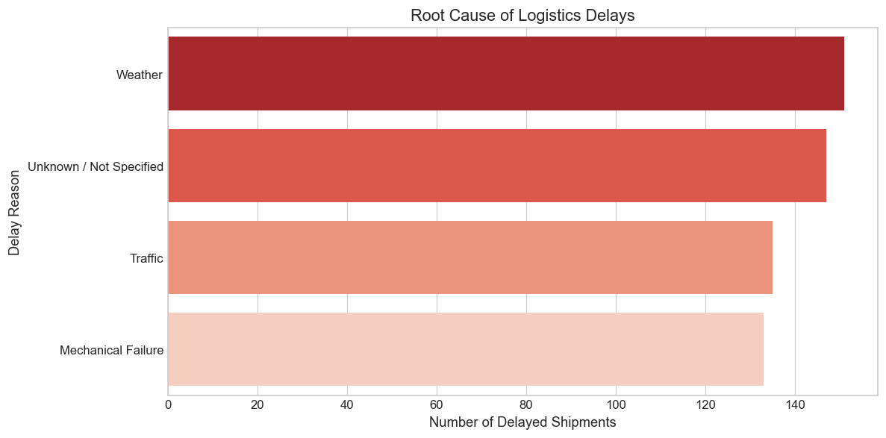
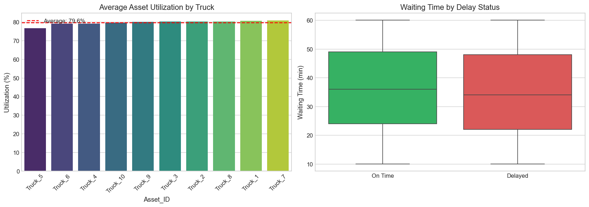
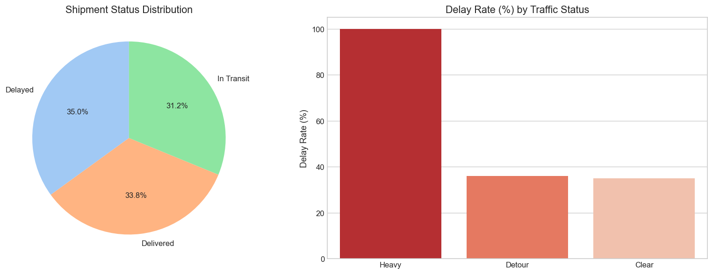
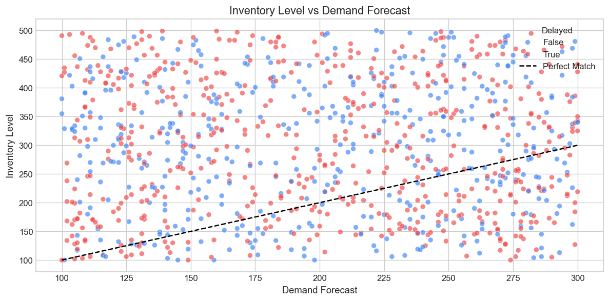
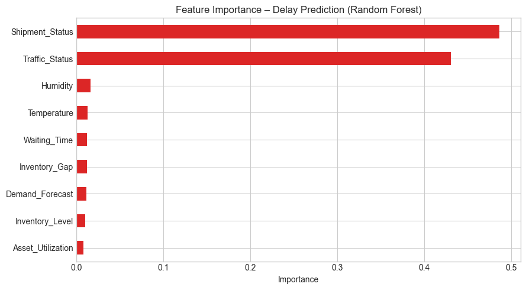
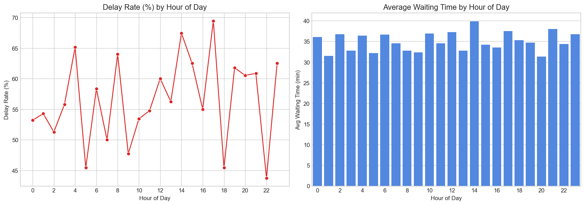
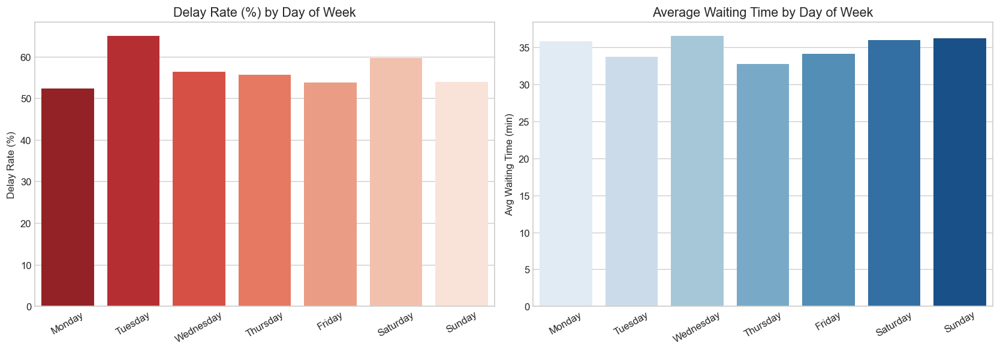
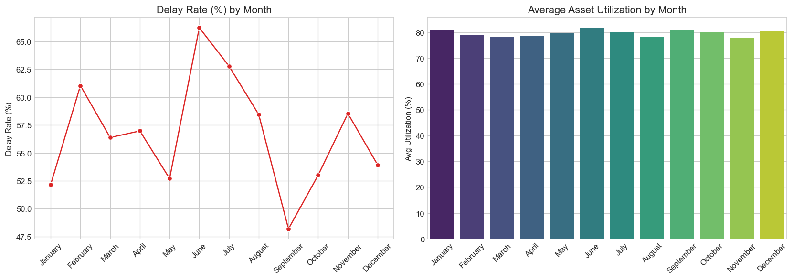
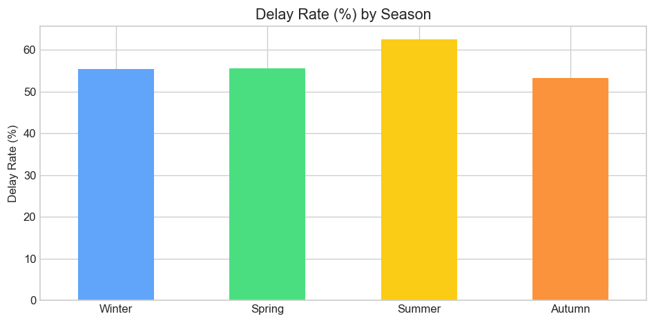
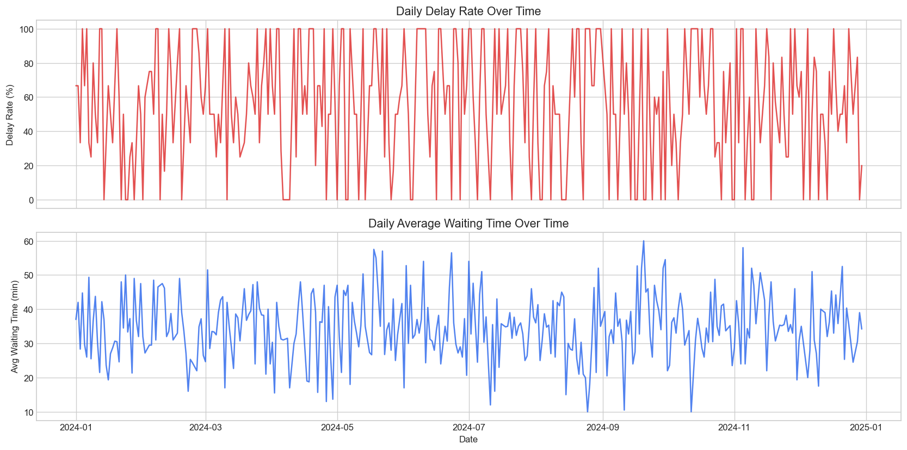

# 🚚 Logistics & Supply Chain KPI Analytics

### Interactive Management Dashboard | Root Cause Analysis | Predictive & Temporal Insights

[](https://logistics-kpi-analytics.streamlit.app/)


---

## 🔗 Live Interactive Dashboard

**👉 [Open the Live KPI Dashboard](https://logistics-kpi-analytics.streamlit.app/)**

The dashboard includes:
- Real-time KPI cards (Delay Rate, Asset Utilization, Waiting Time)
- Interactive filters (Asset, Traffic Status, Shipment Status)
- Root Cause Analysis of delays
- Asset performance comparison
- Inventory vs Demand Forecast view
- Export filtered data

---

## 📌 Project Overview

This project demonstrates professional **KPI tracking**, **root cause analysis**, **predictive thinking**, and **temporal pattern analysis** for logistics and supply chain environments.

It is particularly relevant for roles such as:

- **RAD Process Assistant** (Rapid Asset Deployment)
- Logistics / Transportation Coordinator
- Fulfillment Center Process Support
- Global Transportation Logistics (GTL) operations

**Core philosophy:**  
A strong analyst should not only report what already went wrong. The real value is to **anticipate problems before they fully materialize** and enable the team to act early.  
In other words: *prevention is better than reaction*. Accurate prediction and timely action can significantly reduce operational disruptions.

Time is a critical dimension in logistics. Delays, waiting times, and asset utilization often follow patterns by **hour of day**, **day of week**, **month**, and **season**. Understanding these temporal patterns allows better planning, staffing, and proactive intervention.

---

## 📊 Analytical Layers in This Project

| Layer | Focus | Notebook |
|-------|-------|----------|
| **Descriptive** | What happened? (KPI summary, status distribution) | `01_logistics_kpi_analysis.ipynb` |
| **Diagnostic** | Why did it happen? (Root cause of delays) | `01_logistics_kpi_analysis.ipynb` |
| **Predictive** | What is likely to happen? (Delay probability + leading indicators) | `02_predictive_delay_model.ipynb` |
| **Temporal** | When does it happen? (Hour, day, month, season patterns) | `03_temporal_analysis.ipynb` |

---

## 📊 Key Insights from the Analysis

### 1. Delay Root Causes

| Rank | Delay Reason              | Observation |
|------|---------------------------|-----------|
| 1    | Weather                   | Highest driver of delays |
| 2    | Unknown / Not Specified   | Data quality gap – needs better reason capturing |
| 3    | Traffic                   | Significant controllable factor |
| 4    | Mechanical Failure        | Indicates potential maintenance opportunities |

**Insight:** Weather and Traffic together account for a large share of delays. Improving contingency planning for weather and route optimization can have high impact.

### 2. Asset Utilization
- Utilization across trucks is relatively balanced (mostly between **76% – 80.7%**).
- There is limited variation between assets → fleet is used quite evenly.
- Still room for improvement toward higher utilization targets (e.g. 85%+).

### 3. Waiting Time
- Delayed shipments show a wider and higher distribution of waiting time compared to on-time shipments.
- Waiting time is both a symptom and a **leading indicator** of delays.

### 4. Temporal Patterns (Time-based Insights)
- Delay rate and waiting time vary by **hour of day** → some hours are systematically riskier.
- Performance differs across **days of the week** → useful for staffing and capacity planning.
- **Monthly and seasonal** patterns can reveal recurring pressure periods (e.g. weather-related).
- Daily trend view helps detect sudden spikes that need ad-hoc investigation.

### 5. Recommended Actions

| Priority | Action | Expected Impact |
|----------|--------|-----------------|
| High | Set Delay Rate threshold (e.g. 45%) and escalate when breached | Faster reaction to performance drops |
| High | Improve capture of delay reasons (reduce "Unknown") | Better root cause analysis |
| High | Focus weekly reviews on Weather & Traffic delays | Targeted process improvement |
| High | Monitor high-risk hours and weekdays | Better shift & capacity planning |
| Medium | Track Waiting Time as a leading indicator | Earlier detection of bottlenecks |
| Medium | Review asset utilization and reallocate where needed | Higher fleet efficiency |

---

## 🔮 Predictive View & Leading Indicators

A simple machine learning model (Random Forest) was trained to estimate the probability of a logistics delay and to rank the most influential factors.

### Why prediction matters
Reporting historical delays is useful, but the higher value lies in **anticipating risk**.  
A strong analyst helps the organization act *before* the problem becomes expensive or customer-facing.

### Leading Indicators defined in this project

| Leading Indicator | Example Threshold | Suggested Action |
|-------------------|-------------------|------------------|
| Waiting Time | ≥ 45 minutes | Escalate / investigate bottleneck |
| Traffic Status | Heavy or Detour | Review routing options |
| Asset Utilization | < 70% | Check load planning |
| Inventory Gap | Large negative gap | Align with planning team |

**Notebook:** `notebooks/02_predictive_delay_model.ipynb`

---

## 🕒 Temporal Analysis

Because every record has a timestamp, the dataset can be analyzed as a time-aware operational log.

Key time dimensions examined:
- **Hour of day** – identifies peak risk windows
- **Day of week** – reveals weekday vs weekend patterns
- **Month & Season** – surfaces seasonal pressure
- **Daily trend** – detects abnormal spikes over the year

These insights support proactive planning instead of purely reactive firefighting.

**Notebook:** `notebooks/03_temporal_analysis.ipynb`

---

## 🖼️ Analysis Charts

### Root Cause of Delays


### Asset Utilization & Waiting Time


### Shipment Status & Traffic Impact


### Inventory vs Demand Forecast


### Feature Importance (Predictive Model)


### Temporal Patterns






---

## 🛠️ How to Run Locally

```bash
git clone https://github.com/AZFARHAD24511/logistics-kpi-analytics.git
cd logistics-kpi-analytics
pip install -r requirements.txt
streamlit run app.py
```

---

## 📂 Repository Structure

```
logistics-kpi-analytics/
├── app.py                              # Interactive Streamlit Dashboard
├── notebooks/
│   ├── 01_logistics_kpi_analysis.ipynb # Descriptive + Diagnostic analysis
│   ├── 02_predictive_delay_model.ipynb # Predictive model & leading indicators
│   └── 03_temporal_analysis.ipynb      # Hour / Day / Month / Season patterns
├── src/
│   └── kpi_calculator.py
├── data/
│   └── README.md
├── visualizations/                     # Generated charts
├── reports/
│   └── executive_summary.md
├── requirements.txt
└── README.md
```

---

## 📊 Dataset

**Smart Logistics Supply Chain Dataset**

- **Source:** [Kaggle – Smart Logistics Supply Chain Dataset](https://www.kaggle.com/datasets/smart-logistics-supply-chain-dataset)
- **License:** [CC0: Public Domain](https://creativecommons.org/publicdomain/zero/1.0/)
- **Records:** 1,000 rows of simulated 2024 logistics operations
- **Content:** Asset tracking, inventory levels, shipment status, traffic conditions, waiting times, delay reasons, IoT sensor data (temperature, humidity), and demand forecast

The dataset is dedicated to the public domain under **CC0 1.0 Universal**.

---

## 👤 Author

**Azizallah Farhadi**

- GitHub: [AZFARHAD24511](https://github.com/AZFARHAD24511)
- LinkedIn: [Azizallah Farhadi](https://www.linkedin.com/in/azizallah-farhadi-19bb3438/)

---

## 📄 License

- **Project code:** MIT License  
- **Dataset:** [CC0: Public Domain](https://creativecommons.org/publicdomain/zero/1.0/)
